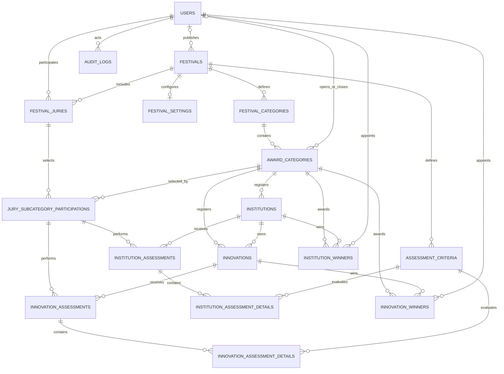

# ERD — Aplikasi Penilaian Festival Inovasi

**Status:** ERD konseptual disetujui.  
**Database target:** MySQL / InnoDB.  
**Konvensi:** nama tabel plural berbahasa Inggris; kolom `snake_case`; primary key `id` (`BIGINT UNSIGNED`).

Dokumen ini menjelaskan desain ERD yang disetujui dan menyelaraskan nama entitas dengan 18 file migration pada paket `festival_inovasi_laravel_migrations_v0_1.zip`.

## 1. Diagram relasi utama

`PASSWORD_RESET_TOKENS` adalah tabel infrastruktur autentikasi Laravel dan tidak memiliki relasi foreign key langsung pada diagram.

`AUDIT_LOGS` menggunakan pasangan `auditable_type` dan `auditable_id` (polymorphic reference), sehingga target audit tidak ditautkan ke satu tabel tertentu dengan foreign key biasa.

## 2. Konsep kategori

Alur navigasi juri adalah:

1. Memilih periode festival.
2. Memilih kategori utama.
3. Memilih subkategori.
4. Melihat seluruh objek dalam subkategori.
5. Menilai seluruh objek tersebut.

`festival_categories.assessment_type` menentukan jenis objek yang dikelola oleh kategori utama:

| Kategori utama (contoh) | `assessment_type` | Objek pada subkategori |
|---|---|---|
| ASN TERINOVATIF | `innovation` | Inovasi |
| LEMBAGA/INSTANSI TERINOVATIF | `institution` | Instansi |

Nama kategori dapat berubah sesuai periode, tetapi jenis penilaian dan relasi kategori harus dijaga setelah penilaian dimulai.

## 3. Data dictionary

Semua tabel menggunakan `id` sebagai primary key kecuali disebutkan lain. Kolom waktu umumnya memakai `created_at` dan `updated_at` sesuai konvensi Laravel.

### 3.1 `users`

Akun pengguna terautentikasi. Pengunjung tidak disimpan sebagai user.

| Kolom | Tipe | Keterangan |
|---|---|---|
| `id` | BIGINT UNSIGNED | PK |
| `name` | VARCHAR(255) | Nama pengguna |
| `email` | VARCHAR(255) | Email, UNIQUE |
| `email_verified_at` | TIMESTAMP NULL | Verifikasi email |
| `password` | VARCHAR(255) | Password hash |
| `role` | VARCHAR(20) | `superadmin` / `jury` |
| `is_active` | BOOLEAN | Status akun |
| `remember_token` | VARCHAR(100) NULL | Token remember me |
| `created_at`, `updated_at` | TIMESTAMP | Timestamp |
| `deleted_at` | TIMESTAMP NULL | Soft delete |

### 3.2 `password_reset_tokens`

| Kolom | Tipe | Keterangan |
|---|---|---|
| `email` | VARCHAR(255) | PK |
| `token` | VARCHAR(255) | Token reset |
| `created_at` | TIMESTAMP NULL | Waktu dibuat |

### 3.3 `festivals`

| Kolom | Tipe | Keterangan |
|---|---|---|
| `id` | BIGINT UNSIGNED | PK |
| `year` | SMALLINT UNSIGNED | Tahun; UNIQUE |
| `name` | VARCHAR(255) | Nama festival |
| `status` | VARCHAR(20) | `preparation`, `ongoing`, `completed` |
| `results_published_at` | TIMESTAMP NULL | Waktu publikasi |
| `results_published_by` | BIGINT UNSIGNED NULL | FK → `users.id` |
| `created_at`, `updated_at` | TIMESTAMP | Timestamp |

### 3.4 `festival_settings`

| Kolom | Tipe | Keterangan |
|---|---|---|
| `id` | BIGINT UNSIGNED | PK |
| `festival_id` | BIGINT UNSIGNED | FK → `festivals.id`; UNIQUE |
| `organizer_name` | VARCHAR(255) | Nama penyelenggara |
| `organizer_logo_path` | VARCHAR(255) NULL | Path logo |
| `report_title` | VARCHAR(255) NULL | Judul laporan |
| `report_footer` | VARCHAR(255) NULL | Footer laporan |
| `created_at`, `updated_at` | TIMESTAMP | Timestamp |

Relasi `festivals` ke `festival_settings` adalah 1:1.

### 3.5 `festival_categories`

| Kolom | Tipe | Keterangan |
|---|---|---|
| `id` | BIGINT UNSIGNED | PK |
| `festival_id` | BIGINT UNSIGNED | FK → `festivals.id` |
| `name` | VARCHAR(255) | Nama kategori utama |
| `assessment_type` | VARCHAR(20) | `innovation` / `institution` |
| `sort_order` | SMALLINT UNSIGNED | Urutan tampilan |
| `created_at`, `updated_at` | TIMESTAMP | Timestamp |

Unique: `(festival_id, name)` dan key komposit `(festival_id, id)` untuk relasi komposit.

### 3.6 `award_categories`

| Kolom | Tipe | Keterangan |
|---|---|---|
| `id` | BIGINT UNSIGNED | PK |
| `festival_id` | BIGINT UNSIGNED | Konteks periode |
| `festival_category_id` | BIGINT UNSIGNED | FK komposit → `festival_categories` |
| `name` | VARCHAR(255) | Nama subkategori |
| `winner_count` | SMALLINT UNSIGNED | Jumlah pemenang yang ditentukan superadmin |
| `scoring_status` | VARCHAR(20) | `preparation`, `open`, `closed` |
| `opened_at` | TIMESTAMP NULL | Waktu dibuka |
| `opened_by` | BIGINT UNSIGNED NULL | FK → `users.id` |
| `closed_at` | TIMESTAMP NULL | Waktu ditutup |
| `closed_by` | BIGINT UNSIGNED NULL | FK → `users.id` |
| `sort_order` | SMALLINT UNSIGNED | Urutan tampilan |
| `created_at`, `updated_at` | TIMESTAMP | Timestamp |

Relasi: satu `festival_category` memiliki banyak `award_categories`.

### 3.7 `institutions`

| Kolom | Tipe | Keterangan |
|---|---|---|
| `id` | BIGINT UNSIGNED | PK |
| `festival_id` | BIGINT UNSIGNED | Konteks periode |
| `award_category_id` | BIGINT UNSIGNED | FK komposit → `award_categories` |
| `name` | VARCHAR(255) | Nama instansi |
| `created_at`, `updated_at` | TIMESTAMP | Timestamp |
| `deleted_at` | TIMESTAMP NULL | Soft delete |

Setiap instansi berada pada satu subkategori instansi. Satu instansi dapat memiliki banyak inovasi.

### 3.8 `innovations`

| Kolom | Tipe | Keterangan |
|---|---|---|
| `id` | BIGINT UNSIGNED | PK |
| `festival_id` | BIGINT UNSIGNED | Konteks periode |
| `award_category_id` | BIGINT UNSIGNED | FK komposit → `award_categories` |
| `institution_id` | BIGINT UNSIGNED | FK komposit → `institutions` dalam festival yang sama |
| `name` | VARCHAR(255) | Nama inovasi |
| `innovator_name` | VARCHAR(255) | Satu nama inovator |
| `created_at`, `updated_at` | TIMESTAMP | Timestamp |
| `deleted_at` | TIMESTAMP NULL | Soft delete |

Setiap inovasi mempunyai satu subkategori ASN, satu instansi, dan satu inovator. Kategori inovasi tidak harus sama dengan kategori instansi.

### 3.9 `festival_juries`

| Kolom | Tipe | Keterangan |
|---|---|---|
| `id` | BIGINT UNSIGNED | PK |
| `festival_id` | BIGINT UNSIGNED | FK → `festivals.id` |
| `user_id` | BIGINT UNSIGNED | FK → `users.id` |
| `status` | VARCHAR(20) | `active` / `inactive` |
| `created_at`, `updated_at` | TIMESTAMP | Timestamp |

Unique: `(festival_id, user_id)`. Satu akun juri dapat digunakan pada banyak festival melalui record berbeda.

### 3.10 `jury_subcategory_participations`

| Kolom | Tipe | Keterangan |
|---|---|---|
| `id` | BIGINT UNSIGNED | PK |
| `festival_id` | BIGINT UNSIGNED | Konteks periode |
| `festival_jury_id` | BIGINT UNSIGNED | FK komposit → `festival_juries` |
| `award_category_id` | BIGINT UNSIGNED | FK komposit → `award_categories` |
| `status` | VARCHAR(20) | `selected`, `in_progress`, `completed` |
| `selected_at` | TIMESTAMP | Waktu memilih |
| `completed_at` | TIMESTAMP NULL | Waktu selesai |
| `created_at`, `updated_at` | TIMESTAMP | Timestamp |

Unique: `(festival_jury_id, award_category_id)`. Partisipasi ini mencatat subkategori yang dipilih juri. Daftar partisipasi dikunci ketika subkategori dibuka.

### 3.11 `assessment_criteria`

| Kolom | Tipe | Keterangan |
|---|---|---|
| `id` | BIGINT UNSIGNED | PK |
| `festival_id` | BIGINT UNSIGNED | FK → `festivals.id` |
| `assessment_type` | VARCHAR(20) | `innovation` / `institution` |
| `name` | VARCHAR(255) | Nama kriteria |
| `weight` | TINYINT UNSIGNED | Bobot |
| `sort_order` | SMALLINT UNSIGNED | Urutan |
| `created_at`, `updated_at` | TIMESTAMP | Timestamp |

Unique: `(festival_id, assessment_type, name)`. Total bobot untuk setiap kombinasi festival dan jenis penilaian harus 100%; validasi lintas-row dilakukan oleh aplikasi.

### 3.12 `innovation_assessments`

| Kolom | Tipe | Keterangan |
|---|---|---|
| `id` | BIGINT UNSIGNED | PK |
| `festival_id` | BIGINT UNSIGNED | Konteks periode |
| `award_category_id` | BIGINT UNSIGNED | Konteks subkategori |
| `jury_subcategory_participation_id` | BIGINT UNSIGNED | FK komposit → partisipasi juri |
| `innovation_id` | BIGINT UNSIGNED | FK komposit → `innovations` |
| `status` | VARCHAR(30) | `draft`, `submitted`, `locked`, `revision_requested` |
| `submitted_at` | TIMESTAMP NULL | Waktu submit |
| `locked_at` | TIMESTAMP NULL | Waktu dikunci |
| `created_at`, `updated_at` | TIMESTAMP | Timestamp |

Unique: `(jury_subcategory_participation_id, innovation_id)`.

### 3.13 `innovation_assessment_details`

| Kolom | Tipe | Keterangan |
|---|---|---|
| `id` | BIGINT UNSIGNED | PK |
| `festival_id` | BIGINT UNSIGNED | Konteks periode |
| `assessment_type` | VARCHAR(20) | Konstan `innovation` |
| `innovation_assessment_id` | BIGINT UNSIGNED | FK komposit → header penilaian |
| `assessment_criterion_id` | BIGINT UNSIGNED | FK komposit → kriteria inovasi |
| `score` | TINYINT UNSIGNED | Nilai; validasi aplikasi 6–10 |
| `created_at`, `updated_at` | TIMESTAMP | Timestamp |

Unique: `(innovation_assessment_id, assessment_criterion_id)`.

### 3.14 `institution_assessments`

| Kolom | Tipe | Keterangan |
|---|---|---|
| `id` | BIGINT UNSIGNED | PK |
| `festival_id` | BIGINT UNSIGNED | Konteks periode |
| `award_category_id` | BIGINT UNSIGNED | Konteks subkategori |
| `jury_subcategory_participation_id` | BIGINT UNSIGNED | FK komposit → partisipasi juri |
| `institution_id` | BIGINT UNSIGNED | FK komposit → `institutions` |
| `status` | VARCHAR(30) | `draft`, `submitted`, `locked`, `revision_requested` |
| `submitted_at` | TIMESTAMP NULL | Waktu submit |
| `locked_at` | TIMESTAMP NULL | Waktu dikunci |
| `created_at`, `updated_at` | TIMESTAMP | Timestamp |

Unique: `(jury_subcategory_participation_id, institution_id)`.

### 3.15 `institution_assessment_details`

| Kolom | Tipe | Keterangan |
|---|---|---|
| `id` | BIGINT UNSIGNED | PK |
| `festival_id` | BIGINT UNSIGNED | Konteks periode |
| `assessment_type` | VARCHAR(20) | Konstan `institution` |
| `institution_assessment_id` | BIGINT UNSIGNED | FK komposit → header penilaian |
| `assessment_criterion_id` | BIGINT UNSIGNED | FK komposit → kriteria instansi |
| `score` | TINYINT UNSIGNED | Nilai; validasi aplikasi 6–10 |
| `created_at`, `updated_at` | TIMESTAMP | Timestamp |

Unique: `(institution_assessment_id, assessment_criterion_id)`.

### 3.16 `innovation_winners`

| Kolom | Tipe | Keterangan |
|---|---|---|
| `id` | BIGINT UNSIGNED | PK |
| `festival_id` | BIGINT UNSIGNED | Konteks periode |
| `award_category_id` | BIGINT UNSIGNED | Subkategori |
| `innovation_id` | BIGINT UNSIGNED | FK komposit → inovasi |
| `position` | SMALLINT UNSIGNED | Posisi juara |
| `appointed_by` | BIGINT UNSIGNED | FK → `users.id` |
| `appointed_at` | TIMESTAMP | Waktu penetapan |
| `notes` | TEXT NULL | Catatan |
| `created_at`, `updated_at` | TIMESTAMP | Timestamp |

Unique: `(festival_id, award_category_id, position)` dan `(festival_id, award_category_id, innovation_id)`.

### 3.17 `institution_winners`

Struktur sama dengan `innovation_winners`, tetapi `institution_id` menggantikan `innovation_id`.

Unique: `(festival_id, award_category_id, position)` dan `(festival_id, award_category_id, institution_id)`.

### 3.18 `audit_logs`

| Kolom | Tipe | Keterangan |
|---|---|---|
| `id` | BIGINT UNSIGNED | PK |
| `actor_user_id` | BIGINT UNSIGNED NULL | FK → `users.id` |
| `action` | VARCHAR(100) | Nama aktivitas |
| `auditable_type` | VARCHAR(100) | Alias tipe objek audit |
| `auditable_id` | BIGINT UNSIGNED | ID objek audit |
| `old_values` | JSON NULL | Nilai lama |
| `new_values` | JSON NULL | Nilai baru |
| `ip_address` | VARCHAR(45) NULL | IP pengguna |
| `created_at` | TIMESTAMP | Waktu aktivitas |

Gunakan morph map/alias stabil untuk `auditable_type`; jangan bergantung pada nama class PHP yang mungkin berubah.

## 4. Kardinalitas relasi

| Parent | Child | Kardinalitas | Keterangan |
|---|---|---|---|
| `festivals` | `festival_settings` | 1:1 | Satu set pengaturan per festival |
| `festivals` | `festival_categories` | 1:N | Kategori utama per festival |
| `festival_categories` | `award_categories` | 1:N | Subkategori di bawah kategori utama |
| `award_categories` | `institutions` | 1:N | Untuk tipe `institution` |
| `award_categories` | `innovations` | 1:N | Untuk tipe `innovation` |
| `institutions` | `innovations` | 1:N | Satu instansi dapat memiliki beberapa inovasi |
| `festivals` | `festival_juries` | 1:N | Juri yang aktif pada periode |
| `users` | `festival_juries` | 1:N | Akun juri reusable lintas periode |
| `festival_juries` | `jury_subcategory_participations` | 1:N | Partisipasi subkategori juri |
| `award_categories` | `jury_subcategory_participations` | 1:N | Juri yang memilih subkategori |
| `jury_subcategory_participations` | assessment headers | 1:N | Penilaian seluruh objek subkategori |
| assessment headers | assessment details | 1:N | Rincian nilai per kriteria |
| `assessment_criteria` | assessment details | 1:N | Kriteria digunakan pada banyak detail |
| `award_categories` | winner records | 1:N | Pemenang per subkategori |
| `users` | winner records | 1:N | Superadmin penetap |
| `users` | `audit_logs` | 1:N | Pelaku perubahan |

## 5. Key constraints dan integritas

### 5.1 Unique constraints utama
- `users.email` unik.
- `festivals.year` unik.
- `festival_juries`: `(festival_id, user_id)` unik.
- `festival_categories`: `(festival_id, name)` unik.
- `award_categories`: `(festival_category_id, name)` unik.
- `jury_subcategory_participations`: `(festival_jury_id, award_category_id)` unik.
- `innovation_assessments`: `(jury_subcategory_participation_id, innovation_id)` unik.
- `institution_assessments`: `(jury_subcategory_participation_id, institution_id)` unik.
- Detail penilaian: kombinasi header dan kriteria unik.
- Winner: satu posisi per subkategori dan satu objek tidak boleh memperoleh dua posisi pada subkategori yang sama.

### 5.2 Composite foreign keys
Composite foreign key menggunakan `festival_id` dan ID entitas terkait untuk memastikan data berada dalam periode yang sama, khususnya:
- `award_categories` → `festival_categories`.
- `institutions` → `award_categories`.
- `innovations` → `award_categories` dan `institutions`.
- Partisipasi juri → festival_juries dan award_categories.
- Header assessment → partisipasi dan objek yang dinilai.
- Detail assessment → header dan kriteria dengan tipe assessment yang sesuai.
- Winner → objek yang menjadi pemenang.

### 5.3 Validasi yang tetap wajib dilakukan pada Laravel
- `role` hanya `superadmin` atau `jury`.
- `assessment_type` hanya `innovation` atau `institution`.
- Objek peserta harus sesuai tipe kategori utama.
- Nilai `score` harus integer 6–10.
- Total bobot per festival dan jenis penilaian harus 100.
- Detail penilaian harus menggunakan kriteria dari festival dan jenis penilaian yang benar.
- Partisipasi juri hanya dapat dibuat ketika subkategori `preparation`.
- Saat subkategori berubah menjadi `open`, roster juri dan daftar peserta dikunci dalam satu transaksi.
- Juri hanya dapat menilai objek di subkategori yang diikuti.
- Partisipasi selesai hanya jika seluruh objek yang wajib telah dinilai lengkap dan dikirim.
- Subkategori tidak boleh `closed` sebelum semua penilaian yang diwajibkan selesai dan dikunci, kecuali ada pengecualian manual superadmin yang diaudit.
- Hanya hasil yang lengkap dan locked digunakan untuk hasil final.
- Perhitungan memakai presisi memadai; tampilan dibulatkan dua angka desimal.
- Saat peserta diubah setelah subkategori dibuka, hanya field identitas yang boleh diedit; relasi peserta tidak boleh berubah.
- `winner_count` harus positif; posisi pemenang tidak boleh melebihi konfigurasi.
- Hasil publik hanya tersedia jika `festivals.results_published_at` telah diisi oleh superadmin.

## 6. Status dan lifecycle

### 6.1 `award_categories.scoring_status`
- `preparation`: data peserta dan partisipasi juri masih dapat disiapkan.
- `open`: roster juri dan peserta terkunci; penilaian berjalan.
- `closed`: penilaian selesai dan dikunci.

### 6.2 `jury_subcategory_participations.status`
- `selected`: juri memilih subkategori.
- `in_progress`: juri mulai menilai objek di subkategori.
- `completed`: semua objek pada subkategori telah dinilai lengkap dan dikirim/dikunci sesuai alur.

### 6.3 Assessment `status`
- `draft`: tersimpan tetapi belum dikirim.
- `submitted`: penilaian lengkap dikirim.
- `locked`: dikunci superadmin.
- `revision_requested`: dibuka kembali oleh superadmin untuk revisi.

## 7. Catatan konsistensi dengan paket migration

Paket migration v0.1 berisi 18 migration yang mengikuti nama tabel pada dokumen ini. Paket tersebut sudah menjalani PHP syntax lint, tetapi belum dieksekusi terhadap instalasi Laravel/MySQL target. Sebelum production:
1. Konfirmasi versi MySQL/MariaDB ArenHost.
2. Jalankan migration pada database lokal kosong.
3. Pastikan semua composite foreign key dapat dibuat.
4. Buat feature tests untuk seluruh validasi aplikasi.
5. Jangan menjalankan `migrate:fresh` pada database berisi data yang perlu dipertahankan.
